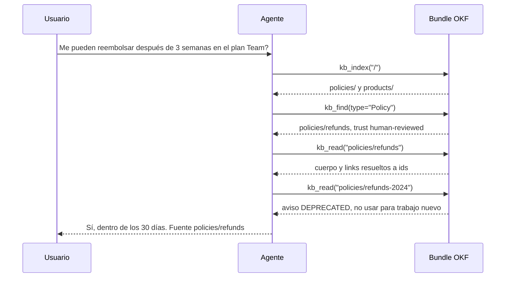

# astromesh-okf

**Que tus agentes *naveguen* el conocimiento en vez de recuperar fragmentos.**

[](https://pypi.org/project/astromesh-okf/)
[](https://pypi.org/project/astromesh-okf/)
[](https://github.com/monaccode/astromesh-okf/actions/workflows/ci.yml)
[](LICENSE)
[](https://github.com/GoogleCloudPlatform/open-knowledge-format)

*[Read in English](README.md)*

El [Open Knowledge Format](https://github.com/GoogleCloudPlatform/open-knowledge-format)
(OKF) es un formato de archivos planos para conocimiento curado: un *bundle* es un
directorio de *conceptos* en Markdown, cada uno con frontmatter YAML (`type`, `title`,
`tags`, `status`, quién lo verificó, cuándo vence) y links Markdown a otros conceptos.
`astromesh-okf` le da a un agente de IA tres tools para recorrer ese bundle como lo haría
una persona: leer el índice, buscar por tipo o tag, abrir un concepto y seguir sus links,
con las señales de confianza y frescura de la spec intactas. Funciona con
LangChain/LangGraph, CrewAI, Google ADK, OpenAI Agents SDK, PydanticAI, LlamaIndex,
smolagents, Microsoft Agent Framework y cualquier cliente MCP, y su núcleo sólo depende de
PyYAML.



## Inicio rápido (30 segundos)

```bash
pip install 'astromesh-okf[langchain]' langchain langchain-openai
```

```python
from langchain.agents import create_agent

from astromesh_okf import Bundle
from astromesh_okf.integrations.langchain import okf_tools

agent = create_agent(
    "openai:gpt-4.1-mini",
    okf_tools("./my-bundle"),
    system_prompt="Answer using the knowledge base tools. Bundle index:\n"
    + Bundle("./my-bundle").index("/"),
)
result = agent.invoke({"messages": [("user", "Can I get a refund after 3 weeks?")]})
print(result["messages"][-1].content)
```

`create_agent` corre sobre LangGraph, así que las mismas tools sirven en un grafo de
LangGraph armado a mano (`ToolNode`).

Sin framework y sin modelo: las tools son métodos comunes que devuelven strings.

```python
from astromesh_okf import OKFTools

kb = OKFTools("./my-bundle")
print(kb.kb_index("/"))
print(kb.kb_find(type="Policy"))
print(kb.kb_read("policies/refunds"))
```

¿Todavía no tenés un bundle? Probá con el de este repo:
`astromesh-okf index examples/bundles/support` (ver [examples/](examples/README.md)).

## Por qué navegar en vez de RAG

**Navegar gana** cuando el conocimiento está curado, enlazado y tipado: políticas,
definiciones de métricas, runbooks, un catálogo de datos. El modelo lee conceptos enteros en
vez de fragmentos, sigue los links que escribieron los autores, ve quién verificó cada
concepto y si está vencido o deprecado, y puede citar el id del concepto del que sacó la
respuesta. No se embebe ni se indexa nada de antemano: cada llamada lee los archivos, así
que una edición del bundle se ve en la siguiente llamada a una tool.

**RAG gana** con corpus enormes y sin estructura: miles de documentos sin estructura que
seguir. `kb_find` es un recorrido simple: parsea todos los archivos de conceptos en cada
llamada, lo que anda bien para cientos o unos pocos miles de conceptos y es la herramienta
equivocada más allá de eso.

**Se combinan.** Dale al agente un retriever para la cola larga y las tools OKF para el
núcleo curado; con `prefix` podés montar varios bundles en un mismo agente.

## Lo que aprendimos construyendo esto en Astromesh

Esta librería es el lector OKF del runtime de agentes
[Astromesh](https://github.com/monaccode/astromesh) (core 0.68.0, donde
`spec.knowledge.bundle` le da a un agente estas mismas tres tools), extraído para que
cualquier framework lo pueda usar. Estas son las decisiones que salieron de usarlo.

**Las señales se anotan, nunca se usan para ocultar contenido.** OKF §5.3 hace de la
confianza una señal para el lector, no un filtro. Un concepto deprecado o sin verificar se
puede leer igual; vuelve con `trust`, `stale`, `status` y `warnings` legibles. La única
excepción es la búsqueda: `kb_find` saltea los conceptos deprecados salvo que
`include_deprecated` sea true, porque un resultado de búsqueda es una recomendación y una
política retirada no debería serlo.

**Los links vuelven ya resueltos.** Los modelos se equivocan con las rutas relativas
(`../policies/x.md` leído desde `products/` es un clásico). `kb_read` devuelve cada link
del cuerpo como un id de concepto que se puede pasar directo a `kb_read`, marca las URLs
externas, señala los directorios, dice si el destino existe y descarta los links que
apuntan fuera del bundle.

**El índice raíz va en el system prompt.** No cambia entre preguntas, así que poner
`Bundle(path).index("/")` en el system prompt ahorra una llamada a una tool en cada
conversación y mantiene estable el prefijo del prompt para el prompt caching.

**Las tools nunca levantan excepciones.** Según el framework, una excepción termina la
corrida del agente o le llega al modelo como traceback. Todo error vuelve como un mensaje
JSON con el que el modelo puede actuar, y un concepto inexistente viene con sugerencias:
`{"error": "concept not found: policies/refund (did you mean: policies/refunds, policies/refunds-2024?)"}`.

**Los modelos inventan argumentos.** Vimos `limit="2"`, `tags="finance"` en vez de una
lista e `include_deprecated="false"` como string; los frameworks con schema estricto mandan
`null` en cada argumento opcional. La coerción vive en la capa de tools: los números se
parsean (con un default cuando no lo son), un tag suelto se vuelve lista,
`"true"`/`"1"`/`"yes"` significan true y cualquier otro string false, y `null` significa
el default.

**El confinamiento de rutas tiene que resolver symlinks antes de chequear.** Un id de
concepto es una ruta que viene del modelo, o sea, entrada no confiable. La ruta se resuelve
(siguiendo symlinks) y recién después se compara con la raíz del bundle, y el `.md` se
agrega *antes* de resolver: si no, `x.md` como symlink a `/etc/passwd` se chequearía como
`x` y se leería igual.

**Ser tolerante, lo dice la spec.** Según OKF §11 sólo dos cosas invalidan un concepto: un
frontmatter que no parsea (o que no es un mapping) y la falta de `type`. Los campos
desconocidos van a `extra`, un `stale_after` ilegible se ignora con un warning en el log, y
los bundles v0.1 también se leen. Los índices y la búsqueda saltean los conceptos inválidos
y los cuentan (`skipped_invalid`); nunca son fatales.

**Verificado contra lo real.** Los cuatro bundles de muestra de Google (`acme_retail` 9
conceptos, `crypto_bitcoin` 9, `ga4` 9, `stackoverflow` 26) se indexan, se buscan y se leen
de punta a punta sin omitir ningún concepto, en cada corrida de CI
([scripts/check_google_samples.py](scripts/check_google_samples.py)).

**Detalles chicos que importan.** Las firmas de las tools usan `typing.Optional` porque el
generador de schemas de Google ADK rechaza `X | None`. Las tools devuelven strings porque es
lo que la mayoría de los frameworks espera. Importar `astromesh_okf` no importa ningún
framework.

## Frameworks

| Framework | Extra | Import | Ejemplo |
|---|---|---|---|
| LangChain / LangGraph | `langchain` | `from astromesh_okf.integrations.langchain import okf_tools` | [langgraph_agent.py](examples/langgraph_agent.py) |
| CrewAI | `crewai` | `from astromesh_okf.integrations.crewai import okf_tools` | [crewai_crew.py](examples/crewai_crew.py) |
| Google ADK | `adk` | `from astromesh_okf.integrations.adk import okf_tools` | [adk_agent.py](examples/adk_agent.py) |
| OpenAI Agents SDK | `openai-agents` | `from astromesh_okf.integrations.openai_agents import okf_tools` | [openai_agents_agent.py](examples/openai_agents_agent.py) |
| PydanticAI (Python 3.11+) | `pydantic-ai` | `from astromesh_okf.integrations.pydantic_ai import okf_tools` | [pydantic_ai_agent.py](examples/pydantic_ai_agent.py) |
| LlamaIndex | `llamaindex` | `from astromesh_okf.integrations.llamaindex import okf_tools` | [llamaindex_agent.py](examples/llamaindex_agent.py) |
| smolagents | `smolagents` | `from astromesh_okf.integrations.smolagents import okf_tools` | [smolagents_agent.py](examples/smolagents_agent.py) |
| Microsoft Agent Framework | `agent-framework` | `from astromesh_okf.integrations.agent_framework import okf_tools` | [agent_framework_agent.py](examples/agent_framework_agent.py) |
| MCP (Claude Desktop, Claude Code, Cursor, cualquier cliente MCP) | `mcp` | `astromesh-okf mcp ./my-bundle` | [examples/mcp/](examples/mcp/claude_desktop_config.json) |
| Cualquier cosa que acepte funciones Python | ninguno | `OKFTools("./my-bundle").functions()` | [plain_python.py](examples/plain_python.py) |

Se instala con `pip install 'astromesh-okf[<extra>]'`. Cada `okf_tools(bundle, prefix="")`
devuelve los objetos de tool propios del framework; los snippets de abajo asumen
`SYSTEM = "Answer using the knowledge base tools. Bundle index:\n" + Bundle("./my-bundle").index("/")`.
Los paquetes de modelos van aparte: ver [docs/integrations.md](docs/integrations.md).

**CrewAI**

```python
from crewai import Agent
from astromesh_okf.integrations.crewai import okf_tools

agent = Agent(
    role="Support agent",
    goal="Answer from the bundle",
    backstory=SYSTEM,
    tools=okf_tools("./my-bundle"),
)
```

**Google ADK**

```python
from google.adk.agents import Agent
from astromesh_okf.integrations.adk import okf_tools

agent = Agent(
    name="support", model="gemini-2.5-flash", instruction=SYSTEM, tools=okf_tools("./my-bundle")
)
```

**OpenAI Agents SDK**

```python
from agents import Agent, Runner
from astromesh_okf.integrations.openai_agents import okf_tools

agent = Agent(name="support", instructions=SYSTEM, tools=okf_tools("./my-bundle"))
print(Runner.run_sync(agent, "Can I get a refund?").final_output)
```

**PydanticAI**

```python
from pydantic_ai import Agent
from astromesh_okf.integrations.pydantic_ai import okf_tools

agent = Agent("openai:gpt-4.1-mini", tools=okf_tools("./my-bundle"), system_prompt=SYSTEM)
print(agent.run_sync("Can I get a refund?").output)
```

**LlamaIndex**

```python
from llama_index.core.agent.workflow import FunctionAgent
from llama_index.llms.openai import OpenAI
from astromesh_okf.integrations.llamaindex import okf_tools

agent = FunctionAgent(
    tools=okf_tools("./my-bundle"), llm=OpenAI(model="gpt-4.1-mini"), system_prompt=SYSTEM
)


async def main():
    print(await agent.run("Can I get a refund?"))
```

**smolagents**

```python
from smolagents import OpenAIModel, ToolCallingAgent
from astromesh_okf.integrations.smolagents import okf_tools

agent = ToolCallingAgent(
    tools=okf_tools("./my-bundle"), model=OpenAIModel("gpt-4.1-mini"), instructions=SYSTEM
)
print(agent.run("Can I get a refund?"))
```

**Microsoft Agent Framework**

```python
from agent_framework import Agent
from agent_framework.openai import OpenAIChatCompletionClient
from astromesh_okf.integrations.agent_framework import okf_tools

agent = Agent(
    OpenAIChatCompletionClient(model="gpt-4.1-mini"), SYSTEM, tools=okf_tools("./my-bundle")
)
```

**MCP** — Claude Desktop (`claude_desktop_config.json`) o Cursor (`.cursor/mcp.json`):

```json
{ "mcpServers": { "okf-support": { "command": "uvx", "args": ["--from", "astromesh-okf[mcp]", "astromesh-okf", "mcp", "/absolute/path/to/bundle"] } } }
```

Claude Code:

```bash
claude mcp add okf-support -- uvx --from 'astromesh-okf[mcp]' astromesh-okf mcp /absolute/path/to/bundle
```

**Funciones planas** — con nombre, tipadas y con docstrings estilo Google escritos para el
modelo:

```python
from astromesh_okf import OKFTools

kb_index, kb_read, kb_find = OKFTools("./my-bundle").functions()
```

## Las tres tools

| Tool | Argumentos | Devuelve |
|---|---|---|
| `kb_index` | `path="/"` | índice Markdown de un directorio |
| `kb_read` | `concept_id` (obligatorio; acepta un `/` inicial y `.md`) | concepto en JSON |
| `kb_find` | `text`, `type`, `tags`, `include_deprecated=False`, `limit=20` | resultados de búsqueda en JSON |

**`kb_index`** devuelve el `index.md` propio del directorio (sin frontmatter) o, si no
tiene, uno sintetizado con el formato de OKF §8: subdirectorios y después conceptos como
`* [Title](/id) - description [Type, status, stale]`.

**`kb_read`** devuelve:

```json
{
  "id": "policies/refunds", "type": "Policy", "title": "Refund policy",
  "description": "Customers can ask for a full refund within 30 days of purchase.",
  "status": "stable", "trust": "human-reviewed", "stale": false,
  "tags": ["support", "refunds"], "warnings": [],
  "extra": {"generated": {"by": "human:support-lead", "at": "2026-09-01T12:00:00+00:00"}},
  "body": "# Rule\n\nA full refund is available within 30 days...",
  "links": [{"id": "products/plans", "exists": true}, {"id": "policies/refunds-2024", "exists": true}]
}
```

Los links son `{"id", "exists"}`, `{"id", "dir": true, "exists"}` para directorios, o
`{"url", "external": true}`.

**`kb_find`** compara `type` exacto (sin distinguir mayúsculas), exige *todos* los `tags` y
busca `text` en título, descripción, tags y cuerpo, poniendo las coincidencias de
encabezado antes que las del cuerpo. `limit` se acota a 1–100. Devuelve
`{"results": [{"id", "type", "title", "description", "status", "trust", "stale"}, ...], "skipped_invalid": 0}`.

**Los errores** vuelven como `{"error": "..."}`, nunca como excepción:

| Mensaje | Cuándo |
|---|---|
| `outside bundle: <input>` | la ruta resuelve fuera de la raíz del bundle (symlinks incluidos) |
| `concept not found: <id>` + ` (did you mean: a, b?)` | no existe ese concepto; hasta tres ids parecidos |
| `not a concept: <id>` | un directorio, `index.md`/`log.md` o un archivo que no es Markdown |
| `not a directory: <path>` | `kb_index` sobre una ruta que no es un directorio existente |
| `invalid concept <id>: <reason>` | `missing frontmatter`, `unterminated frontmatter`, `unparseable frontmatter (...)`, `frontmatter is not a mapping`, `missing type`, `not UTF-8`, `unreadable (...)` |
| `invalid index: <path>` | un `index.md` que no es UTF-8 o no se puede leer |
| `bundle read failed: <detail>` | cualquier otro error de E/S (permisos, un archivo borrado a mitad de lectura) |

**Varios bundles, un agente:** `prefix` renombra las tools.

```python
tools = okf_tools("./support-kb", prefix="support_") + okf_tools("./finance-kb", prefix="finance_")
# support_kb_index, support_kb_read, support_kb_find, finance_kb_index, ...
```

Referencia completa (en inglés): [docs/tools.md](docs/tools.md).

## Confianza y frescura

| Campo | Cómo se calcula |
|---|---|
| `trust` | a partir de `verified` (un evento o una lista): `human-reviewed` si algún `by` empieza con `human:`, `machine-confirmed` si hay algún otro `by`, si no `unverified` |
| `stale` | `true` desde que el momento actual alcanza o pasa `stale_after` (date, datetime o string ISO; sin zona horaria es UTC) |
| `status` | el `status` del frontmatter, en minúsculas; `stable` si falta |
| `warnings` | `DEPRECATED: kept for history; do not use for new work.` / `STALE since <date>: may no longer be accurate.` / `DRAFT: not reviewed; may be incomplete.` |

Decile al agente qué hacer con ellas, por ejemplo:

> Preferí los conceptos con trust `human-reviewed`. Si un concepto en el que te apoyás tiene
> warnings, decilo en tu respuesta. Nunca presentes un concepto deprecado como vigente;
> seguí sus links hasta el que lo reemplaza. Citá el id del concepto del que sacaste la
> respuesta.

## CLI

```bash
astromesh-okf index ./my-bundle [path]          # imprime el índice de un directorio
astromesh-okf read  ./my-bundle policies/refunds  # un concepto en JSON
astromesh-okf find  ./my-bundle --type Policy --tag refunds --text refund [--include-deprecated] [--limit 5]
astromesh-okf mcp   ./my-bundle [--prefix acme_]  # servidor MCP por stdio (requiere el extra [mcp])
```

## Seguridad

- **Sólo lectura.** Nada escribe en el bundle.
- **Confinado a la raíz del bundle.** Cada ruta se resuelve, symlinks incluidos, antes de
  chequearla: los escapes con `../` y los symlinks que apuntan afuera se rechazan, los links
  del cuerpo que salen del bundle se descartan, y un `/` inicial significa la raíz del
  bundle, no la del sistema de archivos.
- **Sólo se leen conceptos `.md`**; `index.md` y `log.md` son reservados, y la búsqueda
  saltea archivos ocultos y directorios que empiezan con punto.
- **No se ejecuta nada.** Los scripts que están junto a los conceptos (por ejemplo el código
  detrás de las Attested Computations de OKF) no son conceptos: `kb_read` los rechaza y
  nada los corre.
- **El contenido del bundle es entrada no confiable para el modelo**, como el resultado de
  cualquier tool. Un concepto puede traer un prompt injection. Montá sólo bundles en los que
  confiás, y tratá lo que el agente hace con ellos como cualquier otra cosa que lee.

## Proyectos relacionados

- **okflib** (Google Cloud): guardar, consultar y validar bundles, con CLI. Usalo para
  escribir o validar bundles.
- **okf-agent-tools**: tools para LangChain, PydanticAI y ADK.
- **okft**: un linter de bundles más un servidor MCP.
- **deep-wiki-agent**: agentes escritor y lector de bundles, sobre deepagents.

Elegí `astromesh-okf` cuando quieras una navegación que respete las señales de confianza,
que nunca levante excepciones y que se comporte igual en muchos frameworks y en MCP. Elegí
`okflib` (u `okft`) para validar o escribir bundles; se combinan bien con esta librería.

## Hoja de ruta: todavía no

- Escribir o editar bundles.
- Validación / linting (usá `okflib` u `okft`).
- Bundles remotos (git, tarball, HTTP): hoy un bundle es un directorio local.
- Tools async nativas: hoy las tools son sincrónicas.

## Contribuir

Issues y pull requests son bienvenidos. Ver [CONTRIBUTING.md](CONTRIBUTING.md) (en inglés)
para el setup, los tests y cómo agregar un adaptador de framework. Documentación (en
inglés): [concepts](docs/concepts.md), [tools](docs/tools.md),
[integrations](docs/integrations.md), [FAQ](docs/faq.md).

## Licencia

[Apache-2.0](LICENSE).

---

Hecho por el equipo de [Astromesh](https://monaccode.github.io/astromesh/) — Monaccode.
