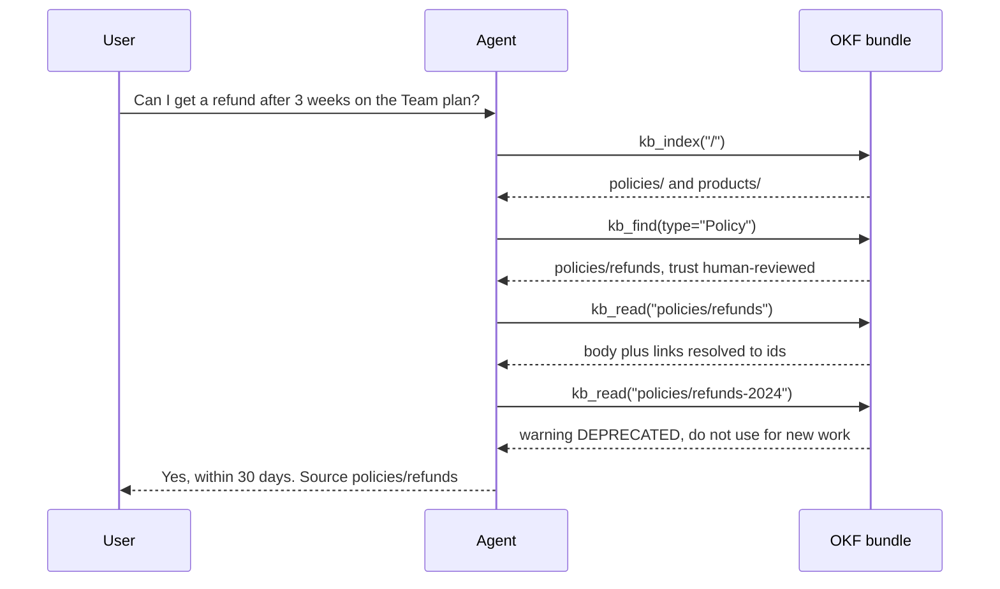

# astromesh-okf

**Let your agents *navigate* knowledge instead of retrieving chunks.**

[](https://pypi.org/project/astromesh-okf/)
[](https://pypi.org/project/astromesh-okf/)
[](https://github.com/monaccode/astromesh-okf/actions/workflows/ci.yml)
[](LICENSE)
[](https://github.com/GoogleCloudPlatform/open-knowledge-format)

*[Leer en español](README.es.md)*

The [Open Knowledge Format](https://github.com/GoogleCloudPlatform/open-knowledge-format)
(OKF) is a plain-files format for curated knowledge: a *bundle* is a directory of Markdown
*concepts*, each with YAML frontmatter (`type`, `title`, `tags`, `status`, who verified it,
when it goes stale) and Markdown links to other concepts. `astromesh-okf` gives an AI agent
three tools to walk such a bundle like a person would: read the index, search by type or
tag, open a concept and follow its links, with the trust and freshness signals of the spec
intact. It works with LangChain/LangGraph, CrewAI, Google ADK, OpenAI Agents SDK,
PydanticAI, LlamaIndex, smolagents, Microsoft Agent Framework and any MCP client, and its
core depends only on PyYAML.



## Quickstart (30 seconds)

```bash
pip install 'astromesh-okf[langchain]' langchain langchain-openai
```

```python
from langchain.agents import create_agent

from astromesh_okf import Bundle
from astromesh_okf.integrations.langchain import okf_tools

agent = create_agent(
    "openai:gpt-4.1-mini",
    okf_tools("./my-bundle"),
    system_prompt="Answer using the knowledge base tools. Bundle index:\n"
    + Bundle("./my-bundle").index("/"),
)
result = agent.invoke({"messages": [("user", "Can I get a refund after 3 weeks?")]})
print(result["messages"][-1].content)
```

`create_agent` runs on LangGraph underneath, so the same tools work in a hand-built
LangGraph graph (`ToolNode`).

No framework, no model: the tools are plain methods that return strings.

```python
from astromesh_okf import OKFTools

kb = OKFTools("./my-bundle")
print(kb.kb_index("/"))
print(kb.kb_find(type="Policy"))
print(kb.kb_read("policies/refunds"))
```

No bundle yet? Try the one in this repo:
`astromesh-okf index examples/bundles/support` (see [examples/](examples/README.md)).

## Why navigate instead of RAG

**Navigation wins** when the knowledge is curated, linked and typed: policies, metric
definitions, runbooks, a data catalog. The model reads whole concepts rather than
fragments, follows the links the authors wrote, sees who verified each concept and whether
it is stale or deprecated, and can cite the concept id it answered from. Nothing is
embedded or indexed ahead of time: every call reads the files, so an edit to the bundle is
visible on the next tool call.

**RAG wins** on huge, unstructured corpora: thousands of documents with no structure to
follow. `kb_find` is a plain scan: it parses every concept file on each call, which is fine
for hundreds to a few thousand concepts and the wrong tool beyond that.

**They combine.** Give the agent a retriever for the long tail and the OKF tools for the
curated core; with `prefix` you can mount several bundles in one agent.

## What we learned building this in Astromesh

This library is the OKF reader of the [Astromesh](https://github.com/monaccode/astromesh)
agent runtime (core 0.68.0, where `spec.knowledge.bundle` gives an agent these same three
tools), extracted so that any framework can use it. These are the decisions that came out
of running it.

**Signals are annotated, never used to hide content.** OKF §5.3 makes trust a signal for
the reader, not a filter. A deprecated or unverified concept is still readable; it comes
back with `trust`, `stale`, `status` and human-readable `warnings`. The one exception is
search: `kb_find` skips deprecated concepts unless `include_deprecated` is true, because
a search result is a recommendation and a retired policy should not be one.

**Links come back already resolved.** Models get relative paths wrong (`../policies/x.md`
read from `products/` is a classic). `kb_read` returns every body link as a concept id you
can pass straight back to `kb_read`, marks external URLs, flags directories, says whether
the target exists, and drops links that point outside the bundle.

**The root index belongs in the system prompt.** It does not change between questions, so
putting `Bundle(path).index("/")` in the system prompt saves a tool call on every
conversation and keeps the prompt prefix stable for prompt caching.

**Tools never raise.** Depending on the framework, a raised exception either ends the agent
run or reaches the model as a traceback. Every error comes back as a JSON message the model
can act on, and a missing concept comes with suggestions:
`{"error": "concept not found: policies/refund (did you mean: policies/refunds, policies/refunds-2024?)"}`.

**Models invent arguments.** We saw `limit="2"`, `tags="finance"` instead of a list and
`include_deprecated="false"` as a string; strict-schema frameworks send `null` for every
optional argument. Coercion lives in the tool layer: numbers are parsed (with a default
when they are not), a string tag becomes a list, `"true"`/`"1"`/`"yes"` mean true and any
other string means false, and `null` means the default.

**Path confinement must resolve symlinks before checking.** A concept id is a path from
the model, so it is untrusted input. The path is resolved (following symlinks) and only
then checked against the bundle root, and `.md` is appended *before* resolving: otherwise
`x.md` as a symlink to `/etc/passwd` would be checked as `x` and read anyway.

**Be tolerant, the spec says so.** Per OKF §11 only two things make a concept invalid:
frontmatter that does not parse (or is not a mapping) and a missing `type`. Unknown fields
go to `extra`, an unreadable `stale_after` is ignored with a log warning, and v0.1 bundles
read too. Indexes and search skip invalid concepts and count them (`skipped_invalid`); they
are never fatal.

**Verified against the real thing.** Google's four sample bundles (`acme_retail` 9
concepts, `crypto_bitcoin` 9, `ga4` 9, `stackoverflow` 26) are indexed, searched and read
end to end with zero concepts skipped, on every CI run
([scripts/check_google_samples.py](scripts/check_google_samples.py)).

**Small details that matter.** The tool signatures use `typing.Optional` because
Google ADK's schema builder rejects `X | None`. Tools return strings because that is what
most frameworks expect back. Importing `astromesh_okf` imports no framework at all.

## Frameworks

| Framework | Extra | Import | Example |
|---|---|---|---|
| LangChain / LangGraph | `langchain` | `from astromesh_okf.integrations.langchain import okf_tools` | [langgraph_agent.py](examples/langgraph_agent.py) |
| CrewAI | `crewai` | `from astromesh_okf.integrations.crewai import okf_tools` | [crewai_crew.py](examples/crewai_crew.py) |
| Google ADK | `adk` | `from astromesh_okf.integrations.adk import okf_tools` | [adk_agent.py](examples/adk_agent.py) |
| OpenAI Agents SDK | `openai-agents` | `from astromesh_okf.integrations.openai_agents import okf_tools` | [openai_agents_agent.py](examples/openai_agents_agent.py) |
| PydanticAI (Python 3.11+) | `pydantic-ai` | `from astromesh_okf.integrations.pydantic_ai import okf_tools` | [pydantic_ai_agent.py](examples/pydantic_ai_agent.py) |
| LlamaIndex | `llamaindex` | `from astromesh_okf.integrations.llamaindex import okf_tools` | [llamaindex_agent.py](examples/llamaindex_agent.py) |
| smolagents | `smolagents` | `from astromesh_okf.integrations.smolagents import okf_tools` | [smolagents_agent.py](examples/smolagents_agent.py) |
| Microsoft Agent Framework | `agent-framework` | `from astromesh_okf.integrations.agent_framework import okf_tools` | [agent_framework_agent.py](examples/agent_framework_agent.py) |
| MCP (Claude Desktop, Claude Code, Cursor, any MCP client) | `mcp` | `astromesh-okf mcp ./my-bundle` | [examples/mcp/](examples/mcp/claude_desktop_config.json) |
| Anything that takes Python functions | none | `OKFTools("./my-bundle").functions()` | [plain_python.py](examples/plain_python.py) |

Install with `pip install 'astromesh-okf[<extra>]'`. Every `okf_tools(bundle, prefix="")`
returns the framework's own tool objects; the snippets below assume
`SYSTEM = "Answer using the knowledge base tools. Bundle index:\n" + Bundle("./my-bundle").index("/")`.
Model packages are separate: see [docs/integrations.md](docs/integrations.md).

**CrewAI**

```python
from crewai import Agent
from astromesh_okf.integrations.crewai import okf_tools

agent = Agent(
    role="Support agent",
    goal="Answer from the bundle",
    backstory=SYSTEM,
    tools=okf_tools("./my-bundle"),
)
```

**Google ADK**

```python
from google.adk.agents import Agent
from astromesh_okf.integrations.adk import okf_tools

agent = Agent(
    name="support", model="gemini-2.5-flash", instruction=SYSTEM, tools=okf_tools("./my-bundle")
)
```

**OpenAI Agents SDK**

```python
from agents import Agent, Runner
from astromesh_okf.integrations.openai_agents import okf_tools

agent = Agent(name="support", instructions=SYSTEM, tools=okf_tools("./my-bundle"))
print(Runner.run_sync(agent, "Can I get a refund?").final_output)
```

**PydanticAI**

```python
from pydantic_ai import Agent
from astromesh_okf.integrations.pydantic_ai import okf_tools

agent = Agent("openai:gpt-4.1-mini", tools=okf_tools("./my-bundle"), system_prompt=SYSTEM)
print(agent.run_sync("Can I get a refund?").output)
```

**LlamaIndex**

```python
from llama_index.core.agent.workflow import FunctionAgent
from llama_index.llms.openai import OpenAI
from astromesh_okf.integrations.llamaindex import okf_tools

agent = FunctionAgent(
    tools=okf_tools("./my-bundle"), llm=OpenAI(model="gpt-4.1-mini"), system_prompt=SYSTEM
)


async def main():
    print(await agent.run("Can I get a refund?"))
```

**smolagents**

```python
from smolagents import OpenAIModel, ToolCallingAgent
from astromesh_okf.integrations.smolagents import okf_tools

agent = ToolCallingAgent(
    tools=okf_tools("./my-bundle"), model=OpenAIModel("gpt-4.1-mini"), instructions=SYSTEM
)
print(agent.run("Can I get a refund?"))
```

**Microsoft Agent Framework**

```python
from agent_framework import Agent
from agent_framework.openai import OpenAIChatCompletionClient
from astromesh_okf.integrations.agent_framework import okf_tools

agent = Agent(
    OpenAIChatCompletionClient(model="gpt-4.1-mini"), SYSTEM, tools=okf_tools("./my-bundle")
)
```

**MCP** — Claude Desktop (`claude_desktop_config.json`) or Cursor (`.cursor/mcp.json`):

```json
{ "mcpServers": { "okf-support": { "command": "uvx", "args": ["--from", "astromesh-okf[mcp]", "astromesh-okf", "mcp", "/absolute/path/to/bundle"] } } }
```

Claude Code:

```bash
claude mcp add okf-support -- uvx --from 'astromesh-okf[mcp]' astromesh-okf mcp /absolute/path/to/bundle
```

**Plain functions** — named, typed, with Google-style docstrings written for the model:

```python
from astromesh_okf import OKFTools

kb_index, kb_read, kb_find = OKFTools("./my-bundle").functions()
```

## The three tools

| Tool | Arguments | Returns |
|---|---|---|
| `kb_index` | `path="/"` | Markdown index of a directory |
| `kb_read` | `concept_id` (required; a leading `/` and `.md` are accepted) | JSON concept |
| `kb_find` | `text`, `type`, `tags`, `include_deprecated=False`, `limit=20` | JSON search results |

**`kb_index`** returns the directory's own `index.md` (frontmatter stripped) or, if it has
none, a synthesized one in the OKF §8 format: subdirectories, then concepts as
`* [Title](/id) - description [Type, status, stale]`.

**`kb_read`** returns:

```json
{
  "id": "policies/refunds", "type": "Policy", "title": "Refund policy",
  "description": "Customers can ask for a full refund within 30 days of purchase.",
  "status": "stable", "trust": "human-reviewed", "stale": false,
  "tags": ["support", "refunds"], "warnings": [],
  "extra": {"generated": {"by": "human:support-lead", "at": "2026-09-01T12:00:00+00:00"}},
  "body": "# Rule\n\nA full refund is available within 30 days...",
  "links": [{"id": "products/plans", "exists": true}, {"id": "policies/refunds-2024", "exists": true}]
}
```

Links are `{"id", "exists"}`, `{"id", "dir": true, "exists"}` for directories, or
`{"url", "external": true}`.

**`kb_find`** matches `type` exactly (case-insensitive), requires *all* `tags`, and looks for
`text` in title, description, tags and body, ranking header matches before body matches.
`limit` is clamped to 1–100. It returns
`{"results": [{"id", "type", "title", "description", "status", "trust", "stale"}, ...], "skipped_invalid": 0}`.

**Errors** come back as `{"error": "..."}`, never as an exception:

| Message | When |
|---|---|
| `outside bundle: <input>` | the path resolves outside the bundle root (symlinks included) |
| `concept not found: <id>` + ` (did you mean: a, b?)` | no such concept; up to three close ids |
| `not a concept: <id>` | a directory, `index.md`/`log.md`, or a non-Markdown file |
| `not a directory: <path>` | `kb_index` on a path that is not an existing directory |
| `invalid concept <id>: <reason>` | `missing frontmatter`, `unterminated frontmatter`, `unparseable frontmatter (...)`, `frontmatter is not a mapping`, `missing type`, `not UTF-8`, `unreadable (...)` |
| `invalid index: <path>` | an `index.md` that is not UTF-8 or cannot be read |
| `bundle read failed: <detail>` | any other I/O error (permissions, a file removed mid-read) |

**Several bundles, one agent:** `prefix` renames the tools.

```python
tools = okf_tools("./support-kb", prefix="support_") + okf_tools("./finance-kb", prefix="finance_")
# support_kb_index, support_kb_read, support_kb_find, finance_kb_index, ...
```

Full reference: [docs/tools.md](docs/tools.md).

## Trust and freshness

| Field | How it is computed |
|---|---|
| `trust` | from `verified` (one event or a list): `human-reviewed` if any `by` starts with `human:`, `machine-confirmed` if there is any other `by`, otherwise `unverified` |
| `stale` | `true` once now is at or past `stale_after` (date, datetime or ISO string; no timezone means UTC) |
| `status` | the frontmatter `status`, lowercased; `stable` when absent |
| `warnings` | `DEPRECATED: kept for history; do not use for new work.` / `STALE since <date>: may no longer be accurate.` / `DRAFT: not reviewed; may be incomplete.` |

Tell the agent what to do with them, for example:

> Prefer concepts with trust `human-reviewed`. If a concept you rely on has warnings, say so
> in your answer. Never present a deprecated concept as current; follow its links to the one
> that replaces it. Cite the concept id you answered from.

## CLI

```bash
astromesh-okf index ./my-bundle [path]          # print a directory index
astromesh-okf read  ./my-bundle policies/refunds  # one concept as JSON
astromesh-okf find  ./my-bundle --type Policy --tag refunds --text refund [--include-deprecated] [--limit 5]
astromesh-okf mcp   ./my-bundle [--prefix acme_]  # MCP server over stdio (needs the [mcp] extra)
```

## Security

- **Read-only.** Nothing writes to the bundle.
- **Confined to the bundle root.** Every path is resolved, symlinks included, before it is
  checked: `../` escapes and symlinks pointing out are refused, body links that leave the
  bundle are dropped, and a leading `/` means the bundle root, not the filesystem root.
- **Only `.md` concepts are read**; `index.md` and `log.md` are reserved, and search skips
  hidden files and dot-directories.
- **Nothing is executed.** Scripts that sit next to concepts (for example the code behind
  OKF Attested Computations) are not concepts: `kb_read` refuses them and nothing runs them.
- **Bundle content is untrusted input to the model**, like any tool result. A concept can
  carry a prompt injection. Mount only bundles you trust, and treat what the agent does with
  them like anything else it reads.

## Related projects

- **okflib** (Google Cloud): store, query and validate bundles, with a CLI. Use it to
  write or validate bundles.
- **okf-agent-tools**: tools for LangChain, PydanticAI and ADK.
- **okft**: a linter for bundles plus an MCP server.
- **deep-wiki-agent**: writer and reader agents for bundles, built on deepagents.

Pick `astromesh-okf` when you want trust-aware, never-raising navigation that behaves the
same across many frameworks and MCP. Pick `okflib` (or `okft`) to validate or write bundles;
they combine fine with this library.

## Roadmap: not yet

- Writing or editing bundles.
- Validation / linting (use `okflib` or `okft`).
- Remote bundles (git, tarball, HTTP): today a bundle is a local directory.
- Async-native tools: today the tools are synchronous.

## Contributing

Issues and pull requests are welcome. See [CONTRIBUTING.md](CONTRIBUTING.md) for setup,
tests and how to add a framework adapter. Docs: [concepts](docs/concepts.md),
[tools](docs/tools.md), [integrations](docs/integrations.md), [FAQ](docs/faq.md).

## License

[Apache-2.0](LICENSE).

---

Built by the [Astromesh](https://monaccode.github.io/astromesh/) team — Monaccode.
